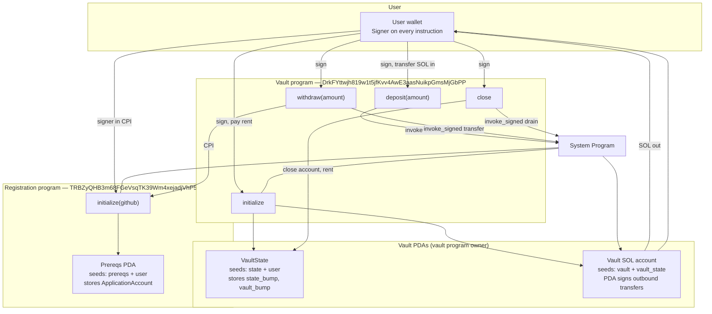

# Turbin3 vault — architecture diagram

Anchor program **`pre_req_vault`** on **Solana devnet**. Each user gets an isolated vault (two PDAs). **Withdraw** returns SOL to the user and CPIs into Turbin3’s **registration** program to record a GitHub username (cohort verification).

## Export for submission

1. Copy the Mermaid block below into [Mermaid Live Editor](https://mermaid.live).  
2. Export **PNG** or **SVG** (recommended width ≥ 1200px).  
3. Attach to the cohort portal with your repo and video links.

Standalone source: [`architecture-diagram.mmd`](architecture-diagram.mmd)

---

## System diagram

---

## Instruction reference

| Instruction | Signers | Accounts | On-chain effect |
|-------------|---------|----------|-----------------|
| **initialize** | User | `vault_state` (init), `vault` (PDA), System | Creates `VaultState`; records bumps for both PDAs |
| **deposit** | User | `vault`, `vault_state`, System | Lamports: user → vault |
| **withdraw** | User; vault PDA (program) | `vault`, `vault_state`, `application_account`, `application_program`, System | Lamports: vault → user; **CPI** `registration::initialize("worldlabsprotocol-ux")` |
| **close** | User; vault PDA (program) | `vault`, `vault_state` (close), System | Drains vault; closes `VaultState`; rent to user |

---

## PDA derivation

| Account | Seeds | Program |
|---------|--------|---------|
| Vault state | `["state", user_pubkey]` | Vault |
| Vault lamports | `["vault", vault_state_pubkey]` | Vault |
| Registration / prereqs | `["prereqs", user_pubkey]` | Registration |

---

## Verified devnet flow (Phase 3)

Tests ran **once** against the deployed vault (`--skip-deploy`). Registration occurred only on **withdraw**.

| Step | Transaction signature |
|------|------------------------|
| Initialize | `5cQadHMX6WuYnhCjeD6tc9H8r9j1byKKJLCQ2oekcx9Wy5ZrozbugPAiaebyJuPrXuDPr4Aq97wDiutp9PhGRRVS` |
| Deposit (1 SOL) | `5h5KX85ELP3EMAETPXN8dBGtseiHNviDqzpdjdcjQg1orfFwk9bUiKL2Xk7yZizJubKtMZjzwxa9SRb32Mr8GaRD` |
| **Withdraw + registration CPI** | `438pmVMPVd9vL1cLP7HpXheGFveNiSLndCMSpNHvD8mwikKif8HBYzNK1bEeAtppcSSM6pBWRBEQ6XDgMz1gyTby` |
| Close | `2itXiEQstCmaGa7G3viDkuu4zXeoqtRhTJDP8bZ5NYdreZRidRyLWmAnxC7ukbYzBhq7C6aGzN7rUVowL3Y12zRA` |

Registration account: `6cAp3qGX91HWE1LMyfmFP9KAU8J2eFCX6N9Cdp98dWv5` (owner: registration program; GitHub field: `worldlabsprotocol-ux`).
